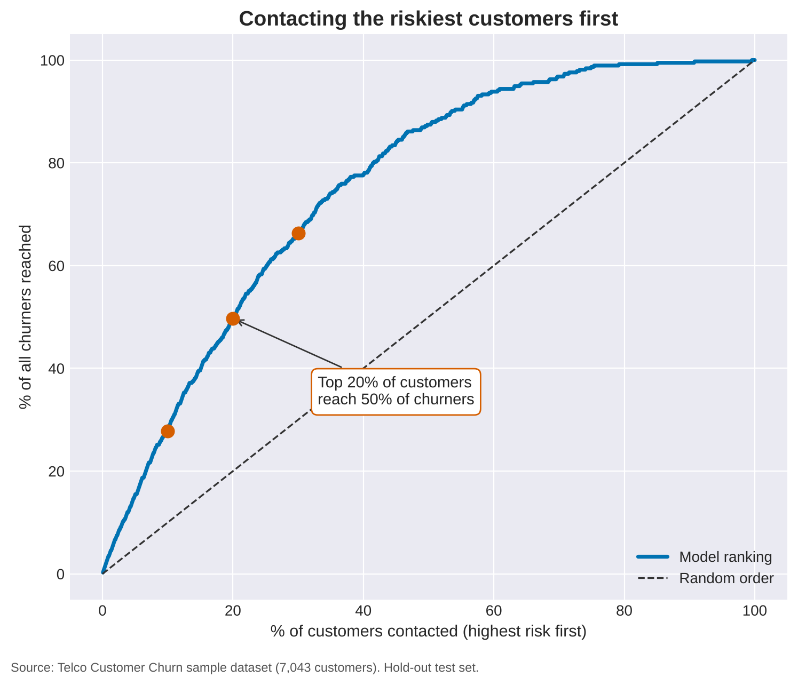
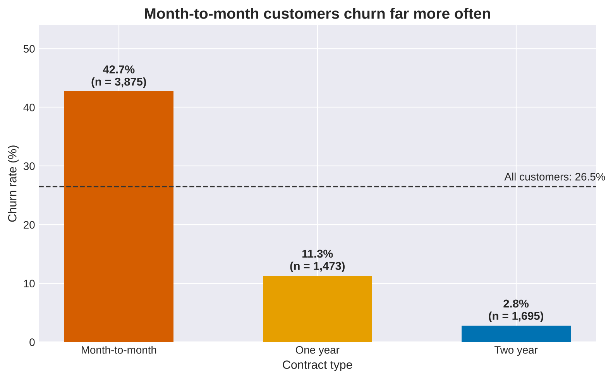
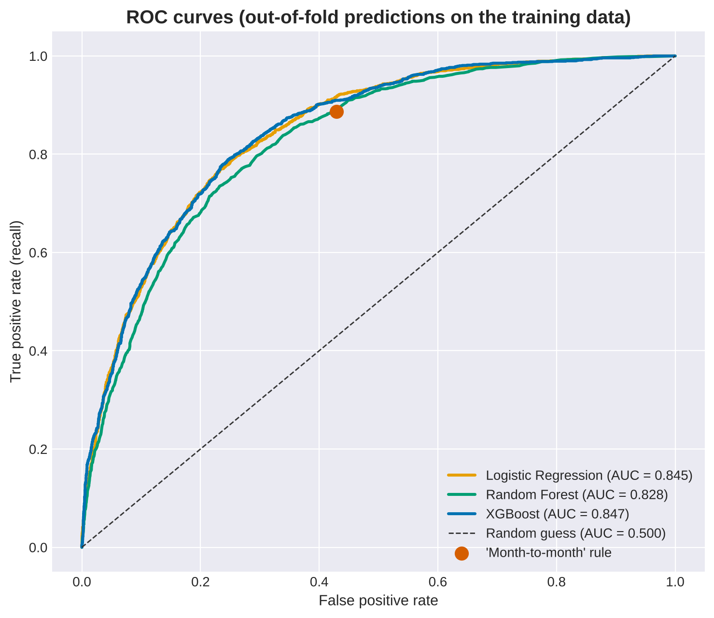
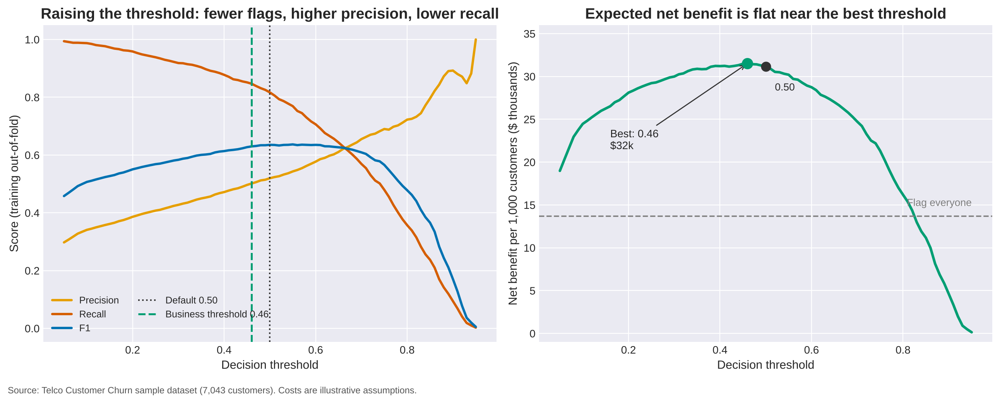
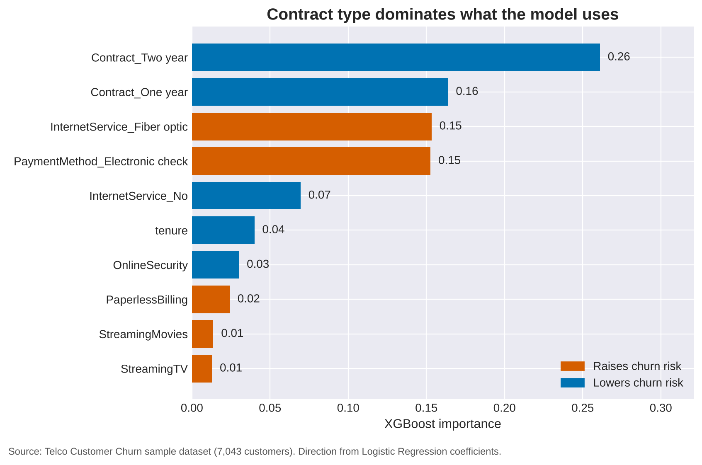
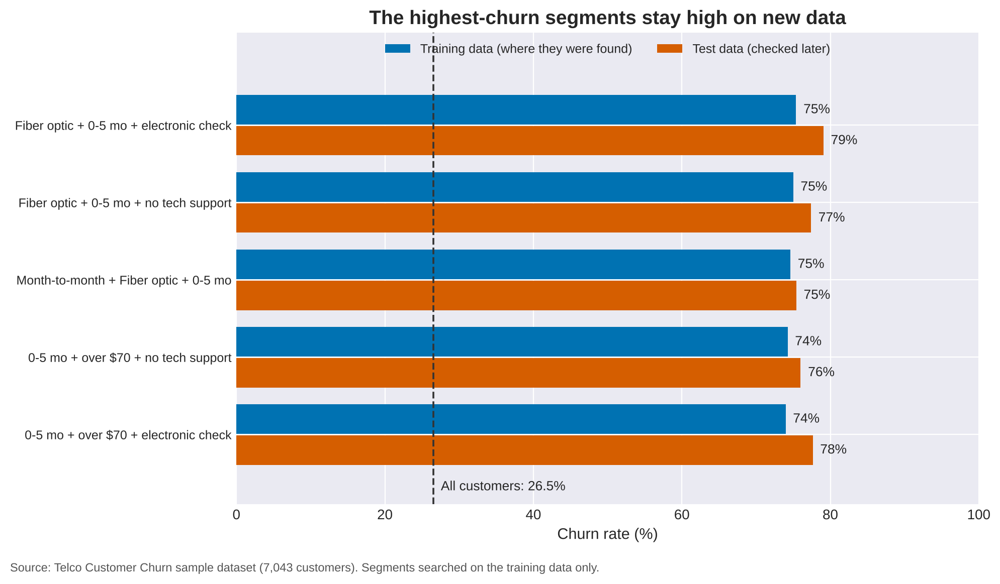
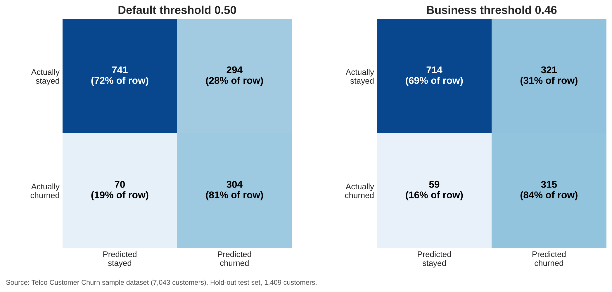

# Customer Churn Prediction

**Finding the telecom customers most likely to leave — and deciding who the retention team should call first.**



*The result in one picture: on a hold-out test set, contacting the 20% of customers with the highest risk score reaches 49.7% of all churners.*

[](https://www.python.org/)
[](https://scikit-learn.org/)
[](https://xgboost.readthedocs.io/)
[](LICENSE)

---

## Overview

An end-to-end binary classification project on the [Telco Customer Churn](https://www.kaggle.com/datasets/blastchar/telco-customer-churn) sample dataset (7,043 customers).

The project goes past "train a model and report accuracy". It covers problem framing under class imbalance, leakage-free preprocessing, model comparison with repeated cross-validation, hyperparameter tuning on training data only, a single honest look at a hold-out test set, and then the part that actually matters to a business: **a threshold chosen from costs, cumulative gains, and customer segments**.

The honest conclusion is that the models are close to each other and close to a one-line rule ("month-to-month customers churn"), so the value is in the decision layer, not in squeezing out another 0.001 of AUC.

## Business problem

A telecom company loses customers every month. If it can rank customers by churn risk, a retention team can spend its limited budget on the right people.

| | |
|---|---|
| **Task** | Binary classification (`Churn`: Yes / No) |
| **Class balance** | 26.5% churned (1,869 of 7,043) — a 2.77 : 1 ratio |
| **Primary metric** | **ROC-AUC** (threshold-independent ranking quality) |
| **Secondary metrics** | PR-AUC, precision, recall, F1, net benefit |
| **Why not accuracy** | Always predicting "No" is 73.5% accurate and catches 0 of 1,869 churners |
| **Validation** | Stratified 80/20 split. Every choice — model, settings, threshold, segments — was made on the **training** data. The 1,409 test customers were used once, to report results |

## Dataset

[Telco Customer Churn](https://www.kaggle.com/datasets/blastchar/telco-customer-churn) — 7,043 customers, 21 columns covering contract, tenure, services, payment method, charges and churn.

- **The raw file is not included here.** See [`data/README.md`](data/README.md).
- The notebooks fall back to a public copy from IBM's GitHub repository if the CSV is missing locally.

Column definitions are in [`docs/data_dictionary.md`](docs/data_dictionary.md).

## Project workflow

| Stage | Notebook | What happens |
|---|---|---|
| 1. Problem + EDA | [`notebooks/01_eda.ipynb`](notebooks/01_eda.ipynb) | Class imbalance, churn by contract / tenure / charges, confounding checks, simple rule baselines |
| 2. Preprocessing | [`notebooks/02_preprocessing_pipeline.ipynb`](notebooks/02_preprocessing_pipeline.ipynb) | Fix `TotalCharges`, encode correctly, build one leak-free pipeline, test class weights and engineered features |
| 3. Model comparison | [`notebooks/03_model_comparison.ipynb`](notebooks/03_model_comparison.ipynb) | Logistic Regression, Random Forest and XGBoost under repeated CV; `GridSearchCV`; one test-set evaluation |
| 4. Business insights | [`notebooks/04_business_insights.ipynb`](notebooks/04_business_insights.ipynb) | Confusion matrices, cost-based threshold, cumulative gains, churn drivers, customer segments |

Reusable code lives in [`src/churn_pipeline.py`](src/churn_pipeline.py) (cleaning + full pipeline) and [`src/churn_models.py`](src/churn_models.py) (one preprocessing pipeline for any estimator).

### Exploratory data analysis

- **Contract type is the strongest signal.** Churn is 42.7% for month-to-month, 11.3% for one-year and 2.8% for two-year contracts — and the gap holds inside every tenure group, so it is not just a tenure effect.
- **New customers leave most.** Churn falls from 47.4% (0–12 months) to 9.5% (49–72 months). Median tenure: 38 months for stayers vs 10 for churners.
- **Monthly charges are confounded.** Churners pay more on average (median $80 vs $64), but *within* DSL and *within* fiber optic, higher charges go with **lower** churn. Fiber customers both pay more and churn more, which makes price look causal when it is not.
- **Two silent data traps.** `TotalCharges` is stored as text with 11 blank values (all brand-new customers). And a naive `map({'Yes': 1, 'No': 0})` would have turned 1,526 values into `NaN` in each of 6 service columns, because of a third value: `"No internet service"`.
- **Rule baselines** set the bar: "month-to-month means churn" reaches recall 0.886 at a false-positive rate of 0.429.

### Data preprocessing

- Drop `customerID` (an identifier, not a feature).
- Convert `TotalCharges` to numeric with `errors="coerce"`.
- Map `"No internet service"` → `"No"` in the six add-on columns **before** binary encoding.
- Binary-encode Yes/No columns and `gender`; one-hot encode `MultipleLines`, `InternetService`, `Contract`, `PaymentMethod` with `drop="first"` to avoid the dummy-variable trap.
- Everything sits inside a scikit-learn `Pipeline` with a `FunctionTransformer` cleaning step, so no statistic is learned from the test set.

**Result: 24 model features** — 3 numeric, 12 binary, 9 one-hot columns.

### Feature engineering

Three candidate features were built and tested: `n_addons` (number of add-on services), `autopay` (automatic payment) and `avg_monthly_spend` (`TotalCharges / tenure`).

They did **not** help: ROC-AUC 0.847 ± 0.013 with and without them, better in only 6 of 15 folds. They were therefore **not** used in the final model — the pipeline ships with the plain cleaned features. This is reported as a negative result on purpose.

## Machine learning methodology

- **Models actually implemented:** Logistic Regression (`class_weight="balanced"`), Random Forest (300 trees, balanced) and XGBoost (`scale_pos_weight=2.77`), all sharing one preprocessing pipeline.
- **Comparison:** `RepeatedStratifiedKFold(5 folds × 3 repeats)` with identical folds for every model, scored on ROC-AUC and PR-AUC.
- **Tuning:** `GridSearchCV` on the training data only; the best cross-validated model was XGBoost.
- **Test discipline:** the 1,409-customer hold-out set was evaluated once, after all choices were frozen. A bootstrap interval is reported for the test AUC.
- **Threshold selection:** chosen on out-of-fold **training** predictions using explicit cost assumptions, then applied unchanged to the test set.

## Results

Cross-validated on the training data (5 folds × 3 repeats, same folds for every model):

| Model | ROC-AUC | PR-AUC |
|---|---|---|
| Logistic Regression | 0.846 ± 0.012 | 0.660 ± 0.017 |
| Random Forest | 0.828 ± 0.013 | 0.620 ± 0.030 |
| XGBoost | 0.847 ± 0.013 | 0.665 ± 0.021 |

**Final model: tuned XGBoost.** On the hold-out test set (1,409 customers, evaluated once): **ROC-AUC 0.846** (95% bootstrap interval 0.823–0.867), **PR-AUC 0.660**.

Decision thresholds on the test set — the business threshold of 0.46 was chosen on training data:

| Threshold | Flagged | Churners caught | False alarms | Precision | Recall | F1 | Net benefit per 1,000 customers* |
|---|---|---|---|---|---|---|---|
| 0.50 (default) | 598 | 304 of 374 | 294 | 0.508 | 0.813 | 0.626 | $30,561 |
| 0.46 (business) | 636 | 315 of 374 | 321 | 0.495 | 0.842 | 0.624 | $31,086 |
| Flag everyone | 1,409 | 374 of 374 | 1,035 | 0.265 | 1.000 | 0.420 | $13,705 |
| Flag nobody | 0 | 0 | 0 | — | 0 | — | $0 |

\*Net benefit uses **illustrative** costs, not real ones: a saved customer is worth $800, an offer costs $50, and an offer saves 30% of churners. Replace these before acting on the number.

## Key findings

- **The models are nearly tied.** XGBoost and Logistic Regression score alike; Random Forest is behind and overfits (train 1.000 vs CV 0.828). Tuning moved CV AUC from 0.847 to 0.849 — inside the noise.
- **Class weights shift the balance, not the ranking.** Recall rose from 0.52 to 0.82 and precision fell from 0.67 to 0.51 while ROC-AUC stayed at 0.847. This is what class weighting is supposed to do.
- **A one-line rule is a strong baseline.** "Month-to-month means churn" catches 88.6% of churners at 42.7% precision and sits almost on the model curves in the ROC chart. Any model has to justify itself against that.
- **The threshold matters less than the cost assumptions.** The expected-benefit curve is flat between 0.39 and 0.49, but the optimal threshold ranges from about 0.10 to 0.95 as offer cost and success rate change.
- **Rank, then call.** The top 10% of customers by risk reach 27.8% of churners, the top 20% reach 49.7%, the top 30% reach 66.3%.
- **Brand-new fiber customers are the highest-risk group.** Segments such as "fiber optic + 0–5 months + electronic check" churn at 74–79%, and this held on the test set.

## Business insights

These are **associations from one snapshot**, so each should be confirmed with a small experiment.

1. **Rank, then call.** Contacting by risk score is far more efficient than contacting at random.
2. **Use the real cost of a mistake.** The threshold depends on what an offer costs and how often it works — see the sensitivity table in notebook 04.
3. **Start with the clear segments.** Month-to-month customers with tenure under 6 months and charges over $70 churn at about 73% vs 26.5% overall (2.8× lift), and the rate held on the test set (74.5%).
4. **Test a contract offer.** Longer contracts go with much lower churn. An A/B test of a "switch to an annual plan" offer would show whether that is cause or just who chooses annual plans.
5. **Do not read price as the cause.** Within an internet service type, higher charges went with *lower* churn, so a blanket price cut is not supported by this data.

## Figures

| | |
|---|---|
|  |  |
| **3.** Churn rate by contract type | **2.** ROC curves for three models, plus the simple rule |
|  |  |
| **4.** Precision, recall and expected benefit by threshold | **5.** What the model uses most |
|  |  |
| **6.** High-churn segments, found on training data and checked on test data | **7.** Confusion matrices at the two thresholds |

Figure 1 (cumulative gains) is at the top of this page.

## Repository structure

```
customer-churn-prediction/
├── README.md
├── LICENSE
├── requirements.txt
├── .gitignore
├── data/
│   └── README.md                        # where to get the CSV (not committed)
├── docs/
│   └── data_dictionary.md               # column definitions
├── notebooks/
│   ├── 01_eda.ipynb
│   ├── 02_preprocessing_pipeline.ipynb
│   ├── 03_model_comparison.ipynb
│   └── 04_business_insights.ipynb
├── src/
│   ├── churn_pipeline.py                # cleaning + full XGBoost pipeline
│   └── churn_models.py                  # one preprocessing pipeline for any estimator
└── outputs/
    ├── figures/                         # the seven final figures
    ├── eda/                             # exploratory charts from notebook 01
    ├── preprocessing/                   # encoding and class-weight checks
    ├── modeling/                        # ROC, tuning and test-set charts
    └── insights/                        # threshold, gains and segment charts
```

## Installation

Tested with Python 3.12, scikit-learn 1.9, pandas 3.0, XGBoost 3.4, NumPy 2.5 and matplotlib 3.11.

```bash
git clone https://github.com/shafimughalp-creator/customer-churn-prediction.git
cd customer-churn-prediction

python -m venv .venv
source .venv/bin/activate          # Windows: .venv\Scripts\activate
pip install -r requirements.txt
```

## How to run

```bash
jupyter notebook
```

Open the notebooks in `notebooks/` and **Run All** in order, `01` → `04`. Each notebook re-downloads the dataset if `data/` is empty.

On one CPU core the four notebooks took roughly 10 seconds, 20 seconds, 1.5 minutes and 10 seconds. All random seeds are fixed, and the committed notebooks already contain their outputs.

## Limitations

- The cost numbers are illustrative. With real costs the best threshold could move a lot.
- Model scores are **not calibrated probabilities** (class weights inflate them), so a calibration step is needed before using them in expected-value maths.
- One sample dataset, one split, no time dimension — drift over time cannot be tested.
- The highest-churn segments overlap (mostly slices of "new fiber customers") and each contains only 76–122 test customers, so those rates are rough.
- Everything here is an association. Retention offers should be tested in a real experiment.
- The fallback data URL points at a third-party copy that may change.

## Next steps

- Calibrate the probabilities (isotonic or Platt) and re-derive the threshold on calibrated scores.
- Add SHAP for per-customer explanations.
- Tune Random Forest properly (it was clearly overfitting) and try LightGBM as a fourth model.
- Add a monitoring plan for drift on fresh data.
- Wrap the final pipeline in a small Streamlit app for the retention team.

## Data and licence

- **Code:** MIT — see [`LICENSE`](LICENSE).
- **Data:** the Telco Customer Churn sample dataset is published by IBM and is available under the terms of its source repository. It is **not** committed here; see [`data/README.md`](data/README.md).

## Author

**Muhammad Shafi Mughal** — BS Artificial Intelligence, Emerson University Multan, Pakistan.

- GitHub: [@shafimughalp-creator](https://github.com/shafimughalp-creator)
- LinkedIn: [muhammad-shafi-mughal](https://www.linkedin.com/in/muhammad-shafi-mughal-97579a3b5)

Built as Project 2 of a self-designed 90-day data science roadmap, learned and documented in public.
